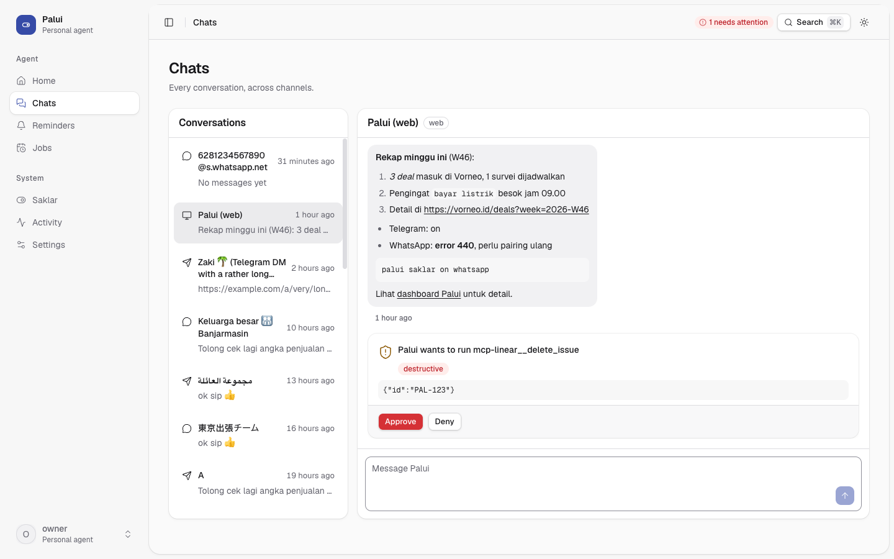

# Palui Agent

A self-hosted personal AI assistant you talk to from WhatsApp, Telegram or a web chat. Channels, models, memory and tools are connectors you add, pause and remove from one dashboard, with no restart.

[Website and docs](https://palui.zakiego.com) · [Getting started](https://palui.zakiego.com/docs/getting-started) · [Changelog](https://palui.zakiego.com/docs/changelog)



Palui is built for one owner on one server. It answers you in Indonesian or English, reminds you on time, runs scheduled jobs, remembers things through a memory service, and reaches your other tools over MCP. Anyone else who messages the bot gets no reply unless you give that chat its own agent.

The name comes from Si Palui, a folk comic character from South Kalimantan.

## Features

- Chat on WhatsApp (linked device), Telegram (bot) and the dashboard's web chat, with voice notes transcribed.
- Reminders and scheduled agent jobs that survive restarts and deploys. Delivery is at least once and nothing is deleted before the channel confirms it.
- Flows: multi-step automations Palui builds from chat, started by a schedule, a chat command, a webhook or a changed value, with every run logged step by step.
- Any Streamable HTTP MCP server as a tool source, with per-tool on/off. Palui is also an MCP server itself, with personal tokens and OAuth.
- Model providers with a configurable base URL (Anthropic Messages and OpenAI-compatible), swappable from the dashboard.
- Built-in connectors for notes, contacts and outbound messages, web fetch and search, file attachments, Google Calendar, an HTTP API caller, a network printer, and inbound webhooks.
- Safety rails enforced by the runtime, not the prompt. Every tool is classed `read`, `write` or `destructive` (unclassified means destructive). Destructive tools always ask you first. After a turn reads untrusted content, writes need approval too.
- Secrets encrypted at rest with AES-256-GCM, and shown masked in the dashboard.
- Passkey sign-in with no sign-up. The owner account comes only from a single-use invite you create on the server.

## Architecture

```
 WhatsApp ─┐
 Telegram ─┼──>  palui serve (one Go binary, one container)  ──>  model providers
 Web chat ─┘     ├─ router, per-chat queues, agent turns            memory service
                 ├─ scheduler (reminders, jobs, flows)              MCP servers
                 ├─ outbox worker (at-least-once delivery)          host bridge (optional)
                 ├─ connector supervisor
                 └─ dashboard, API, auth, /health, migrations
                          │
                          ▼
                 SQLite (WAL) + WhatsApp sessions on one volume
```

An inbound message is written to SQLite as `pending`, routed to a per-chat queue, handled in a turn, and its reply goes through the outbox until the channel acknowledges it. A restart in the middle loses nothing.

| Part | Path | Stack |
|---|---|---|
| Server | `apps/server` | Go, standard library first, pure-Go SQLite (`modernc.org/sqlite`), whatsmeow, go-webauthn, the official MCP Go SDK. No cgo |
| Dashboard | `apps/app` | React 19 SPA, Vite, TanStack Router, Tailwind 4. Built to static files and embedded in the server binary |
| Host bridge | `apps/host-bridge` | Node MCP server that runs an allowlist of CLI commands on the Docker host |
| Website and docs | `apps/site` | Next.js static export and Fumadocs, on Cloudflare Pages |
| Edge | `apps/edge` | Cloudflare Worker that sends app paths to the server and everything else to the site |

The production image is the `palui` binary on a distroless base, about 37 MB with no shell. The same binary is the admin CLI.

`docs/PLAN.md` describes scope and behavior in depth. `docs/GO-PORT.md` records the move of the backend from TypeScript to Go.

## Quick start

You need Docker with Compose and a host name for the dashboard (passkeys don't work on a bare IP).

```bash
git clone https://github.com/zakiego/palui.git
cd palui
cp env.example .env
openssl rand -base64 32        # paste the output as MASTER_KEY in .env, and set APP_URL
docker compose up -d --build --wait
docker compose exec app palui owner invite
```

The last command prints a sign-in link that works once and expires in 15 minutes. Open it, register a passkey, then add a model and a channel on the Connectors page. The [getting started guide](https://palui.zakiego.com/docs/getting-started) walks through it.

## Configuration

Only two settings live in `.env`. Every other credential is entered in the dashboard and stored encrypted in the database. `env.example` lists all of them.

| Variable | Required | Default | What it does |
|---|---|---|---|
| `MASTER_KEY` | In production | dev-only key | Encrypts every connector secret. Back it up: a restored database can't be decrypted without it |
| `APP_URL` | Yes | `http://localhost:4890` | Public origin of the dashboard, used for cookies, the passkey domain and invite links |
| `PALUI_TZ` | No | `Asia/Makassar` | Default time zone for reminders and schedules |
| `LOG_LEVEL` | No | `info` | `debug`, `info`, `warn` or `error` |
| `PALUI_PROD_TOKEN_HASHES` | No | empty | sha256 hashes of production channel tokens a dev server must refuse |
| `DATA_DIR` | No | `./data` (`/data` in the image) | Where `palui.db`, WhatsApp sessions and backups live |
| `HOST`, `PORT` | No | `0.0.0.0`, `3000` in the image | Listen address |
| `NODE_ENV` | No | `production` in the image | `production` makes `MASTER_KEY` required and turns dev fixtures off |

## Deployment

`compose.yaml` runs one service bound to `127.0.0.1:4802`. Put a reverse proxy or a tunnel (Cloudflare Tunnel, Caddy, Tailscale) in front of it for HTTPS. The healthcheck uses the binary itself and only fails when the database schema is newer than the code, so a channel outage never fails a deploy.

To upgrade, pull and run `docker compose up -d --build --wait` again. Migrations run on start. See the docs for [backups](https://palui.zakiego.com/docs/self-hosting/backups), [upgrades and rollback](https://palui.zakiego.com/docs/self-hosting/upgrades) and the [tunnel setup](https://palui.zakiego.com/docs/self-hosting/tunnel).

`ops/` and `scripts/backup.sh` are the scripts the author uses on a Mac host (launchd jobs, encrypted backups to Cloudflare R2). Every path in them can be overridden with an environment variable, but treat them as examples rather than a supported installer.

## Development

You need Go (version in `apps/server/go.mod`), Node 24 and pnpm (version in `package.json`).

```bash
pnpm install
pnpm dev:server    # Go server on :3000
pnpm dev           # dashboard on :4890
pnpm test && pnpm typecheck && pnpm build
```

See [CONTRIBUTING.md](CONTRIBUTING.md) for the fixture datasets and the conventions, and [SECURITY.md](SECURITY.md) to report a vulnerability.

## License

[MIT](LICENSE)
